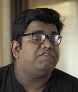
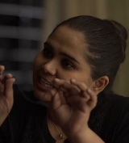
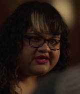
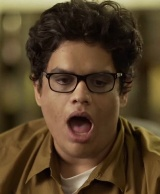
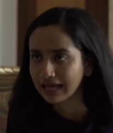
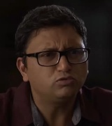
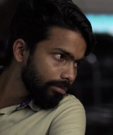

# LocalDub

LocalDub takes a Hindi or Urdu video and gives it back dubbed in English, with each character speaking in a voice cloned from their own original lines and the original music and sound effects kept underneath.

I'm Muhammad Asim, a student developer from Pakistan. I built this for the Meta Global AI Developer Hackathon 2026 (Indie Developer track, "Build for Your World"), with no budget, on free Kaggle CPU machines.

**Built by Muhammad Asim, a student developer, with AI coding assistance; the pipeline runs on Meta's open-weight models.** The code was written with the help of an AI coding assistant; the Meta models (Muse Glimmer, Omnilingual ASR, Demucs) are what the pipeline itself runs on, they did not write the code.

- Demo video (2:55): https://github.com/TurabDevs/localdub/releases/download/demo-v2/localdub_demo_v5.mp4
- Full 5-minute English dub (latest, v6): https://github.com/TurabDevs/localdub/releases/download/demo-v2/aib_depression_en_v6.webm
- Frame-by-frame AV-QA report of that dub: [`results/avqa_v6/report.html`](results/avqa_v6/report.html) (v5 for comparison: [`results/avqa_v5/report.html`](results/avqa_v5/report.html))
- All releases: https://github.com/TurabDevs/localdub/releases

## Why I built this

Where I live, almost everything people watch and make is in Urdu, Punjabi, Saraiki or Hindi. There are thousands of creators here making comedy, cooking videos, tutorials and lectures, and their work almost never travels past people who already speak the language. Big channels pay dubbing studios. A kid with a phone and a good sketch can't.

The other direction hurts too. Most good teaching material online is in English, and a lot of students around me (I'm one of them) follow it slower than they should because they are translating in their head the whole time.

Automatic dubbing tools exist, but the ones I tried had the same three problems with our content:

1. Jokes get translated word for word, so they stop being jokes. Hinglish (Hindi and English mixed in one sentence) confuses them badly.
2. Everyone gets the same stock voice, or the wrong voice for the person on screen.
3. Lines don't fit. The dub keeps talking after the actor's mouth has stopped.

LocalDub is my attempt to fix those three things, using models I can actually run.

## Why open-weight models

This part is not a style choice. Pakistan is one of the countries where Meta's hosted Model API is not available. I asked Meta support during the hackathon; they confirmed the restriction and couldn't give an exception or API credits. I also don't have a card or a budget for paid inference.

So every Meta model in LocalDub is an open-weight model that I downloaded and ran myself, offline, inside free Kaggle notebooks. No hosted Meta API, no VPN. That turned out to be the point of the project: if it runs on a free CPU box, it can run for creators who have nothing else either.

The cost of doing it this way is speed. My Kaggle account could only use CPU machines (4 vCPU, 30 GB RAM, no internet inside the kernel), and Muse Glimmer 30B on that hardware generates about 1 token per second. A full first pass on the 5-minute demo clip took around 4 hours of wall-clock time, most of it waiting on Glimmer. It works, it's just slow.

## How it works

```
                     original video (Hindi / Urdu / Hinglish)
                                     |
             +-----------------------+-----------------------+
             |                                               |
     Demucs (Meta) splits the audio                  low-res frames
             |                                               |
   vocals ---+--- music + effects (kept for the final mix)   |
     |                                                       |
  Silero VAD -> speech chunks                                |
     |                                                       |
  Omnilingual ASR (Meta) -> Hindi/Urdu transcript            |
  ECAPA embeddings -> rough voice clusters                   |
     |                                                       |
     +---------------> Muse Glimmer 30B (Meta) <-------------+
                       - sees a frame for each line: who is on screen,
                         gender, age, role, face visible or not
                       - reads the whole script at once and writes
                         English that keeps the joke, a full and a short
                         version per line, plus an emotion tag
                                     |
             voice clone per line (reference = that speaker's own
             original line from the separated vocals), Fish Audio TTS
                                     |
             fit each line into its original time slot
             (pick the version that fits, small tempo change only if needed)
                                     |
             mix over the original music + effects -> dubbed video
                                     |
             LISTEN / QA pass on my own output:
             - timing, overflow, spill into the next line
             - loudness and pitch of each dubbed line vs the original line
             - Omnilingual ASR re-transcribes the English dub -> word error rate
                                     |
             WATCH pass (AV-QA, frame by frame, every 50 ms):
             - face on screen + mouth moving (YuNet + MediaPipe face mesh)
               while the original speaks and the dub is silent?
             - dub speaking over silence, laughs/groans dropped,
               music + effects ducked or missing, loudness, clipping, drift
                                     |
             bad lines go back to Muse Glimmer with a note -> rewrite -> re-dub;
             timing and mix problems are fixed in the placement step
```

| Step | Model / tool | Runs where |
|---|---|---|
| Separate voice from music | Meta Demucs `htdemucs_ft` (MIT) | Kaggle CPU kernel, offline |
| Hindi/Urdu speech recognition | Meta Omnilingual ASR `omniASR_CTC_1B_v2` (Apache-2.0), through a Hugging Face `Wav2Vec2ForCTC` conversion because the official package needs Python <= 3.12 and Kaggle has 3.13 | Kaggle CPU kernel, offline |
| Who is on screen, per line | Meta Muse Glimmer 30B (Apache-2.0), GGUF Q4_K_M + vision projector, llama.cpp | Kaggle CPU kernel, offline |
| Translation, short versions, emotion tags | Meta Muse Glimmer 30B | Kaggle CPU kernel, offline |
| Rewrites of lines that failed QA | Meta Muse Glimmer 30B | Kaggle CPU kernel, offline |
| Checking what the dub actually says | Meta Omnilingual ASR | Kaggle CPU kernel, offline |
| Speech segments | Silero VAD (MIT) | Kaggle |
| Voice clusters | SpeechBrain ECAPA (Apache-2.0) | Kaggle |
| English voices | Fish Audio `s2.1-pro-free` zero-shot cloning (free tier, hosted) | API call |
| Fitting and mixing | ffmpeg, numpy | my sandbox |
| Watching the result (AV-QA) | OpenCV YuNet face detector + MediaPipe Face Landmarker (both Apache-2.0), numpy, ffmpeg EBU R128 | my sandbox, CPU |

Before llama.cpp starts, the Glimmer weights are checked by sha256 against the official `meta-models/Muse-Glimmer-30B-GGUF` release, because they come from a Kaggle mirror.

## Who is talking: the character stage

Until Nov 1 every dubbed line got its voice from the audio chunk it was cut from. When two people talked inside one chunk, one voice spoke for both, and nothing in my listen checks could see it. So I added a stage before dubbing that works out who the characters are and who is talking when:

1. **Faces across shots** (`pipeline/char_faces.py`): YuNet finds faces on the low-res frames, SFace embeddings group them into identities across cuts (17 face ids in the AIB clip).
2. **Words and speakers** (Kaggle CPU kernel): Whisper large-v3 (open weights, faster-whisper int8) with word timestamps on the Demucs vocals, plus ECAPA speaker embeddings for every sub-segment, on top of the diarization step.
3. **Active speaker** (`pipeline/char_link.py`): a speech unit belongs to the face whose mouth moves with it. Units nobody's mouth matches are grouped by voice and marked off-screen (phone calls, narration). Result for the clip: 101 speech units, 82 confirmed by a face, 18 characters, 10 with real screen time.
4. **Turns** (`pipeline/make_char_split.py`): 14 dubbed lines turned out to be several people taking turns. They are split at the speaker changes into 40 turns, and Muse Glimmer writes the English for each turn with the whole script as context.
5. **One voice per character** (`dub.py` with `CHARS` / `CHARMAP`): every line of a character is cloned from that character's own face-confirmed speech, never from someone else's chunk.

Gender and age below are automatic estimates (pitch and Muse Glimmer's per-line labels), not facts about the actors, and some are clearly off: C6's thumbnail is a man while the pitch estimate says female. Full profiles, with sample lines, are in `characters/`.

| | id | on screen | speaks | pitch p10 / median / p90 | gender (estimate) | age (estimate, Glimmer) | style | voice used in v7 |
|---|---|---|---|---|---|---|---|---|
|  | C0 | 93.4 s | 56.3 s, 20 lines | 150 / 206 / 286 Hz | unsure (pitch says female, Glimmer says male) | young | loud / animated | cloned from 10.8 s of this character's own speech (2 clips where the face detector saw this face talking) |
|  | C1 | 51.6 s | 44.2 s, 13 lines | 123 / 163 / 223 Hz | male | adult | loud / animated | cloned from 12.1 s of this character's own speech (3 clips where the face detector saw this face talking) |
|  | C2 | 37.6 s | 27.9 s, 10 lines | 170 / 199 / 240 Hz | female | adult | loud / animated | cloned from 10.2 s of this character's own speech (2 clips where the face detector saw this face talking) |
|  | C3 | 25.9 s | 26.3 s, 8 lines | 172 / 240 / 356 Hz | female | adult | loud / animated | cloned from 10.2 s of this character's own speech (3 clips where the face detector saw this face talking) |
|  | C4 | 32.1 s | 21.5 s, 8 lines | 126 / 199 / 279 Hz | unsure (pitch says female, Glimmer says male) | adult | loud / animated | cloned from 11.3 s of this character's own speech (3 clips where the face detector saw this face talking) |
|  | C5 | 15.5 s | 14.2 s, 5 lines | 193 / 253 / 356 Hz | unsure (pitch says female, Glimmer says male) | young | medium | cloned from 10.1 s of this character's own speech (3 clips where the face detector saw this face talking) |
|  | C6 | 17.1 s | 12.0 s, 4 lines | 170 / 232 / 266 Hz | female | n/a | soft | cloned from 9.6 s of this character's own speech (4 clips where the face detector saw this face talking) |
|  | C7 | 10.2 s | 11.5 s, 4 lines | 114 / 133 / 165 Hz | male | adult | medium | cloned from 7.1 s of this character's own speech (2 clips where the face detector saw this face talking) |
|  | C8 | off-screen voice | 6.0 s, 2 lines | 115 / 128 / 141 Hz | male | young | loud / animated | cloned from 6.0 s of this off-screen voice (2 clips grouped by voice) |
|  | C9 | off-screen voice | 5.0 s, 2 lines | 130 / 191 / 298 Hz | female | n/a | medium | cloned from 5.0 s of this off-screen voice (2 clips grouped by voice) |
|  | C10 | 28.6 s | 3.3 s, 2 lines | 119 / 137 / 225 Hz | male | adult | soft | cloned from 3.3 s of this character's own speech (2 clips where the face detector saw this face talking) |

7 more voice groups speak for less than 2 s each (C11 to C17); they are in `characters/` too.

How v6 did on this check (`pipeline/char_mismatch.py`, `results/characters_aib/mismatch_v6.json`): 13 of 33 dubbed lines are voiced as the wrong character for at least part of the line, 37.9 s of 134.1 s of face-confirmed speech (28 %) is in another character's voice, and 15 lines use a voice cloned from a chunk where several people talk.

v7 is the first dub that uses this stage. Measured against the original voices (pitch gap per turn, in semitones): mean gap 2.17 (v6) to 1.01 (v7); turns off by more than 4 semitones 16 to 2; lines with several speakers 3.63 to 1.35; per-character pitch spread 3.21 to 2.35. The voice now follows the speaker. The cost: the audio/video check flags more spots where a mouth moves and the dub is silent (9 to 14 flags, 7.0 s to 9.4 s total). Most are under 1.3 s, and the mouth detector is only medium-confidence (AUC 0.62), so I treat them as leads. v8 retimes those lines. v8 (relaxed stretch limits on the same voices) did that: high-severity flags 14 to 9, flagged time 9.4 s to 5.5 s, source speech covered by the dub 88.9% to 91.4%, mouth/dub correlation 0.38 to 0.40. Still open: 8 talking-face-with-silent-dub spots and 4 speech-not-dubbed spots.

### Frame-by-frame speaker check (Nov 2, v10)

v9 still had characters speaking in someone else's voice, and the automatic stage above could not tell me where. So I checked it at a much finer grain (`pipeline/charwin/`, data in `results/char_check/`):

1. **Windows**: the whole clip cut into 1.5 s windows every 0.5 s (613 windows). For each one: shot cuts, every visible face with its id and a lip-motion score, speech activity on the Demucs vocals, an ECAPA speaker embedding and the Whisper large-v3 words (`results/char_check/timeline.csv`).
2. **Contact sheets**: one image per 10 s with a frame per window, face boxes, face id, lip score, speech activity and the character + voice the dub used there. Every dubbed line was checked against these sheets, and where the automation disagreed with the picture the mapping was corrected by hand, with the reason written down (`results/char_check/manual_fixes.json`).
3. **People, not face clusters**: the 10 people in the sketch are defined from the sheets, with the time ranges where each is on screen and talking (`results/char_check/persons.json`). As a cross-check, the voice embeddings of those ranges agree with the picture labels on 98.3 % of windows (228 of 232, leave-one-out).
4. **Off-screen and reaction shots**: decided by voice-embedding similarity to those verified samples (for example the mother's reaction shot at 135-136 s is the father still talking).
5. **v10**: lines re-split at every speaker change using the word timings, one fixed Fish voice per person cloned only from that person's own verified speech, and only the lines that changed were re-dubbed (19 new takes). Everything else from v9 is kept as it was.

What was actually wrong in v9:

- **The face clusters were impure.** One face id held three different people: the guy in the black t-shirt, the father in one shot, and the whole end card (the guy in the brown shirt, the guy on the phone, the t-shirt guy). So the "t-shirt guy" voice was cloned from the end card, which is mostly the brown-shirt guy. His two dubbed lines (52 s "Bacteria die in two months", 140 s "These doctors run a scam") were in the wrong man's voice.
- Another face id merged the curly-haired woman with the brown-shirt guy (64-73 s), so her voice was cloned from a clip that included him. Her three dubbed lines (197 s, 200 s, 219 s) came out as a man/woman blend.
- **Speaker changes inside one line**: 44.3 s (the guy on the phone hands over to the brown-shirt guy, "don't overthink it"), 157.5 s ("determination" is the brown-shirt guy, not the guy on the phone), 206.6 s (the montage cuts from the brown-shirt guy to the t-shirt guy in the middle of "change your country, change your continent"), 139.8 s (the t-shirt guy starts while the father's line was still running).
- The woman in purple had a voice reference that ended with the brown-shirt guy saying "Then how you got typhoid like that?" (55.4 s).

The metric: **character accuracy** = share of dubbed speech seconds where the dub voice (the person whose speech the voice was cloned from) is the person actually speaking at that moment, checked every 0.1 s against the verified speaker timeline. A voice cloned from a mix of people (no person at 75 % or more of the reference) counts as wrong.

| | v6 | v9 | v10 |
|---|---|---|---|
| character accuracy | 34.4 % (54.4 of 158.0 s) | 83.6 % (102.9 of 123.1 s) | **96.3 %** (118.9 of 123.5 s) |
| heard-voice check: dubbed take's ECAPA embedding is closest to the right person | 59.0 % | 95.6 % | 98.9 % |
| dubbed lines | 33 | 46 | 49 |
| AV-QA high flags (flagged time) | 9 (7.0 s) | 7 (3.6 s) | 5 (2.4 s) |
| original speech covered by the dub | 90.9 % | 92.8 % | 93.3 % |
| loudness (original -15.9 LUFS) | -16.5 LUFS | -16.4 LUFS | -16.3 LUFS |
| lines that overflow their slot | 0 | 0 | 0 |

The remaining 3.7 % in v10 are slivers of at most 0.4 s at line edges, where the end of one person's line touches the start of the next. The heard-voice row compares an English take with Hindi speech, so treat it as a rough second opinion, not proof. v6 is low partly because it dubbed long multi-speaker lines in one voice, which this metric punishes hard. The v10 video: [`localdub_dub_v10.mp4`](https://github.com/TurabDevs/localdub/releases/download/demo-v2/localdub_dub_v10.mp4) (720p) and [`aib_depression_en_v10.webm`](https://github.com/TurabDevs/localdub/releases/download/demo-v2/aib_depression_en_v10.webm).

Also fixed in v10: the mother's "Nikhil, why would I tell?" at 101.3 s sat inside an English line that keeps the original audio, so it was never translated; it is its own dubbed line now.

## Running it

There is a one-command runner, `localdub.py`, that strings the steps together and keeps every step's output in a work folder so it can be resumed:

```
python3 localdub.py dub sketch.webm --src hi --to en --work runs/sketch            # Hindi/Urdu -> English
python3 localdub.py dub talk.mp4   --src en --to ur --work runs/talk --wait 3600   # English -> Urdu
python3 localdub.py status --work runs/talk
```

Steps: `prep` -> `stage1` -> `merge` -> `diarize` -> `jobs` -> `glimmer` -> `tts` -> `mix` -> `avqa` -> `subs` -> `review`.

To be honest about where this stands: the AIB demo and every version in the table below were made by running these steps one at a time (the scripts under `pipeline/` and `cloud/kaggle/`), not by one `localdub.py dub` call. The runner is new (Nov 1). My first end-to-end try with it, a short English -> Urdu clip, got through prep, stage 1, diarization and job building, but the Glimmer step did not start its Kaggle kernels, so that run is not finished. Until it is, treat `localdub.py` as work in progress and the per-step scripts as the way that is actually tested.

`out/review.html` is a review page that needs no server: the dubbed video with a one-key switch to the original, every line with its source text, the dubbed text (editable), how it was fitted, and the AV-QA flags with thumbnails. Mark lines for a new take or fix the text and export `edits.json` (re-voicing from that file is wired into the runner but has the same caveat as above).

## What I measured

The demo clip is a 5 min 08 s comedy sketch by All India Bakchod, "If People Treated Other Illnesses Like They Treat Depression". It's fast, it's Hinglish, people talk over each other, and the whole joke depends on tone, which is exactly why I picked it.

The clip has 58 speech lines. 14 are already in English and keep the original audio. From v2 on, 12 more keep the original audio too: these are laughs, grunts and one-word bits that the ASR spelled in Arabic or Chinese script and that v1 had "translated" into junk like "Uh." or "Man." That leaves 32 lines that are actually dubbed.

There are six versions so far; each one after v1 came out of a round of dub -> listen -> fix (from v6 on: dub -> listen -> watch -> fix). All numbers come from `pipeline/qa_metrics.py`, the Omnilingual ASR listen check and `pipeline/avqa.py` (`results/`).

| | v1 | v2 | v3 | v4 | v5 | v6 |
|---|---|---|---|---|---|---|
| lines dubbed | 44 | 32 | 32 | 32 | 33 | 33 |
| dubbed lines that fit their slot | 42 / 44 | 32 / 32 | 32 / 32 | 32 / 32 | 33 / 33 | 33 / 33 |
| lines that overflow | 2 | 0 | 0 | 0 | 0 | 0 |
| junk one-word dubs from ASR garble | 8 | 0 | 0 | 0 | 0 | 0 |
| voice pitch more than 4 semitones off the original | 11 | 3 | 1 | 1 | 2 | 2 |
| mean pitch gap vs original line | 3.72 st | 2.33 st | 1.97 st | 1.84 st | 1.88 st | 1.94 st |
| mean loudness gap vs original line | 1.65 dB | 0.45 dB | 0.35 dB | 0.63 dB | 0.61 dB | 0.49 dB |
| listen WER, all dubbed lines | 0.289 | 0.187 | 0.144 | 0.123 | 0.151 | 0.131 |
| listen WER on the same 31 lines | 0.116* | 0.187* | 0.144* | 0.123 | 0.152 | |
| max tempo change | 1.08x | 1.13x | 1.13x | 1.13x | 1.13x | 1.14x (and 12 lines slowed to 0.85-0.94x) |
| AV-QA: original speech covered by the dub | | | | | 84.4 % | 90.9 % |
| AV-QA: actor talking, dub silent (high flags) | | | | | 15 spots, 21.2 s | 9 spots, 7.0 s |
| AV-QA: integrated loudness (original -15.9 LUFS) | | | | | -19.0 LUFS | -16.5 LUFS |
| AV-QA: music + effects vs original (median) | | | | | -1.9 dB | +0.1 dB |

*v1-v3 figures are on the same 32 lines (v5 split one of them in two). AV-QA did not exist before v6, so it was run on v5 and v6 only.

What changed in each round:

- **v2**: added a guard so garbled ASR lines keep the original audio, picked voice references by pitch for short lines (a short line can't clone a voice from itself), and sent 20 flagged lines back to Glimmer for a rewrite (18 used). For 5 of those I wrote a note on what the Hindi probably meant, for example that the ASR's "टेंडर" after "Garima broke up with you" is "Tinder". The other 15 only had the measured timing and a syllable target.
- **v3**: re-voiced the 3 lines whose pitch was way off with a different reference.
- **v4**: fixed "Put it on.", which the listen check heard as "vtdn" (WER 1.0 -> 0.0), and moved one line that came out with a heavy accent back to the cluster reference.
- **v5**: went line by line through the two windows the demo video shows and fixed what was wrong in meaning, which the metrics can't see. The opening phone call had both people in one voice, so I split it at the speaker change (pitch drops from about 175 Hz to 125 Hz) and each side now has its own voice. Glimmer rewrote six lines, including the sketch's main joke ("there's no such thing as typhoid, bro"; v4 said "typhoid isn't like that") and a sarcastic question v4 had turned into the opposite ("Tell the whole neighborhood." -> "Whole neighbourhood to know?"). Two lines needed extra takes; I generated five of each and picked by the listen check and pitch. By the numbers v5 is a bit worse than v4 (WER 0.123 -> 0.152), mostly ASR spelling ("our sun", "hart", "brow"), while the lines are now correct. I chose correct over a better score; details in `results/qa_v5.md`.

- **v6**: the first version checked by watching, not only listening. `pipeline/avqa.py` goes through the video every 50 ms and compares the original and the dub: is a face on screen moving its mouth while the original speaks and the dub is silent, did a laugh or a groan disappear, did the music get quieter, is anything clipping or drifting. On v5 it found three real problems I had not heard: (1) most English takes ended before the actor stopped talking, so the dub went quiet while the mouth kept moving (15 spots, 21 s in total); (2) the whole mix was turned down to fit one peak, so the music and effects sat 1.9 dB under the original and the dub was 3 LU quieter overall; (3) only speech lines were mixed, so a 4.5-second groan and the shouts in the broom scene were simply gone (the demo showed the groan as five seconds of silence over a wide-open mouth). Fixes in `pipeline/align.py`: each line follows the actor's phrasing and is slowed gently (never below 0.85x) when the take is short; a longer Glimmer variant is used when the take fills less than 70 % of the line; level is matched on voiced frames; a look-ahead limiter replaces whole-mix scaling; laughs, groans and shouts between lines are kept from the original. Result: 84.4 % -> 90.9 % of the original speech covered, high flags 21.2 s -> 7.0 s, loudness within 0.6 LU of the original, listen WER 0.151 -> 0.131 (part of that is the ASR reading re-timed takes differently). The mouth detector is only moderately reliable (AUC 0.62 against the original speech track, side faces and dark shots are hard), so every flag comes with a thumbnail. Details in `results/qa_v6.md`.

I want to be straight about the two WER rows. The big drop in WER from v1 to v2 is mostly because v2 stopped dubbing the junk lines. On the 32 lines both versions dub, v1 was actually slightly clearer (0.116), v2 and v3 got worse, and v4 got back to almost the same level (0.123) while fixing the overflow, junk and voice problems. A lot of the remaining "errors" are the ASR spelling things its own way ("tiphoid", "mikil" for Nikhil), not wrong speech. Full per-line details, including every Glimmer rewrite, are in `results/qa_v2.md` to `results/qa_v5.md`.

## What doesn't work yet

- **One clip.** Everything above is measured on one 5-minute sketch. I haven't tested it on other creators, other genres, or Punjabi/Saraiki audio yet.
- **Mixed speakers in one chunk.** The voice-activity chunks sometimes hold two people. I fixed the opening phone call by hand-picking the split point from the pitch track; it isn't automatic yet. The speaker clustering also has one big mixed cluster, and short lines that borrow a voice from it can get the wrong person.
- **Hinglish ASR.** Omnilingual ASR handles Hindi well, but English words inside Hindi sentences sometimes come out in the wrong script. Glimmer repairs most of it from context; some meaning still slips (see the rewrite notes).
- **26 of 58 lines keep the original audio.** 14 are fine because they are English. 12 are short laughs and interjections I chose not to dub rather than dub badly.
- **No lip-sync.** Lines fit their time slot, but mouths are not re-animated. AV-QA tells me where a mouth moves with no dub under it; it doesn't fix the mouth shape.
- **Slow-downs.** v6 slows 12 short takes to 0.85-0.94x so they end with the actor. It keeps sync but can sound a little drawn out; a medium-length Glimmer rewrite would be the better fix.
- **The voices are not a Meta model.** The TTS is Fish Audio's free hosted tier. Everything that understands the video is Meta and open-weight; the voice synthesis is not. I'd like to replace it with an open TTS I can run myself.
- **Slow.** CPU only, about 1 token per second for Glimmer. Fine for a demo, not for a creator waiting on an upload.

## Where I want to take it

This is the part I care about most. The hackathon version proves the pipeline; this is what I want LocalDub to become.

1. **Our languages, both ways.** Urdu, Punjabi, Saraiki and Pashto first, then Sindhi, Balochi and more. Omnilingual ASR covers more than 1,600 languages, including many that commercial tools ignore, so the listening side already reaches them. The writing side needs testing language by language.
2. **English into Urdu and Hindi.** The same pipeline in reverse: lectures, tutorials and courses dubbed into Urdu so students here can learn in the language they think in. For me this may matter even more than the Hindi -> English direction.
3. **Education and lectures.** Long, mostly single-speaker videos are the easiest case for this pipeline and probably the most useful one: university lectures, coding tutorials, health information.
4. **Lip-sync with face tracking.** Glimmer already tells me who is on screen and whether their face is visible for each line. Next is tracking that face (SAM 2 / SAM 3) and only re-animating mouths when the face is visible and close enough to matter.
5. **Better voices per character.** Split mixed chunks by speaker, build a clean reference per character, and use Glimmer's on-screen labels to check that the voice matches the person.
6. **A simple web app for creators.** Upload a video, review the script line by line (approve, edit, or ask Glimmer for another version), listen, export. The QA report I already generate is basically the review screen.
7. **An open voice model.** Replace the hosted TTS so the whole thing can run on one machine with no API keys.

## What a budget would unlock

Everything so far was built with zero spend: free Kaggle CPU notebooks (no GPU, no internet inside the kernel), the free tier of one hosted TTS, and my own time. Here is what is waiting on money or compute, honestly:

- **A GPU.** On one 24 GB GPU, Muse Glimmer goes from about 1 token per second to something interactive, and a 5-minute video takes minutes instead of hours. That alone would let me run more rewrite rounds per video and test many clips instead of one.
- **Real lip-sync.** The character stage already knows which face is talking in every shot. GPU lip-sync models could re-animate those mouths for close-up faces; on CPU that is not realistic.
- **Better voices.** Paid voice-cloning tiers and larger open TTS models I wanted to compare but couldn't run or pay for. And an open TTS I host myself, so no API key is needed at all.
- **Real-time and longer videos.** Lectures and full episodes, and eventually live dubbing for streams.
- **More languages, tested properly.** Urdu, Punjabi, Saraiki, Pashto, Sindhi: each one needs listening tests with native speakers, which takes compute and people.

## Supporting this

I'm a student and this is the biggest thing I've built. LocalDub started in October as a private desktop app of mine. For this hackathon I rebuilt the pipeline from scratch and made it open source, because I'd rather other people can use and improve it than keep it on my laptop. I want to keep building it after the hackathon, especially the English -> Urdu direction for students like me and the creator review app.

If you work on dubbing, speech or regional-language AI and want to help, the most useful things are: GPU credits or compute time, feedback from Urdu/Punjabi/Saraiki speakers on the dubs, and creators who would let me try it on their videos. Issues and pull requests on this repo are the easiest way to reach me.

## Repository layout

- `cloud/kaggle/stage1_listen.py`: separation, VAD, ASR and speaker embeddings (offline Kaggle kernel)
- `cloud/kaggle/stage2_glimmer.py`: starts llama.cpp with Muse Glimmer and runs text and image jobs (resumable, can be split across kernels)
- `cloud/kaggle/stage_listen_check.py`: re-transcribes the English dub with Omnilingual ASR
- `cloud/kaggle/kapi.py`, `cloud/kaggle/kup.py`: small Kaggle API client (datasets, kernels, chunked uploads)
- `pipeline/make_jobs.py`: voice clusters -> dubbing lines -> Glimmer cast and translation jobs
- `pipeline/dub.py`: per-line TTS, slot fitting, mixing and the QA report
- `pipeline/align.py`: v6 placement (follow the actor's phrasing), voiced-frame level match, limiter, non-verbal vocals
- `pipeline/avqa_faces.py`: AV-QA visual pass: faces, face mesh, mouth motion, tracking (CPU, resumable in chunks); models via `pipeline/get_avqa_models.sh`
- `pipeline/avqa.py`: AV-QA report (`pair` = dub vs source, `solo` = any finished video such as the demo cut): JSON, HTML with thumbnails, timeline
- `pipeline/subs.py`: dub, source and bilingual subtitles (SRT and WebVTT), optional burn-in
- `pipeline/make_review.py`: the review page (edit / re-take lines, export edits.json)
- `localdub.py`: the one-command runner (resumable steps, chunking for long videos, Kaggle kernels)
- `cloud/kaggle/stage1_diarize.py`: speaker changes inside VAD chunks (sliding-window ECAPA), re-transcribes the split chunks
- `pipeline/qa_metrics.py`: per-line metrics (fit, spill, loudness, pitch vs original, listen WER)
- `pipeline/make_rw_jobs.py`: builds the Glimmer rewrite job for flagged lines
- `pipeline/listen_prep.py`: cuts the dubbed lines for the listen check
- `pipeline/split_line.py`: splits a line that holds two speakers
- `pipeline/make_demo_rw_jobs.py`, `pipeline/split_rewrite.py`: the v5 Glimmer rewrite of the demo-window lines
- `results/`: QA reports, metrics and listen results for every version

## Credits

- Demo source: "If People Treated Other Illnesses Like They Treat Depression" by All India Bakchod (AIB), licensed under [CC BY 3.0](https://creativecommons.org/licenses/by/3.0/). Changes made: the dialogue was translated into English and re-voiced by LocalDub; the music and effects come from the original through source separation.
- Meta open-weight models: Muse Glimmer 30B, Omnilingual ASR, Demucs. Also Silero VAD, SpeechBrain ECAPA, llama.cpp, ffmpeg, and Fish Audio for the voices.

Everything in this repository was written during the hackathon (Oct 27 to Nov 4, 2026). I had an earlier, unrelated desktop prototype with the same name in October 2026; none of its code is used here.

## License

MIT for this repository. The models and libraries keep their own licenses (Muse Glimmer and Omnilingual ASR: Apache-2.0; Demucs: MIT).
