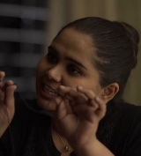
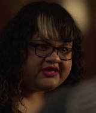
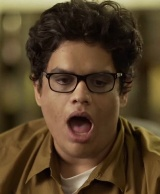
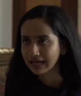
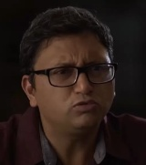

| | id | kind | screen time | speaks in | speaking time | pitch (p10 / median / p90) | gender (estimate) | age (Glimmer, estimate) | style | voice used for the dub |
|---|---|---|---|---|---|---|---|---|---|---|
|  | C0 | on-screen | 93.4 s | 20 lines (24 turns) | 56.3 s | 150 / 206 / 286 Hz | unsure (pitch says female, Glimmer says male) | young | loud / animated | cloned from 10.8 s of this character's own speech (2 clips where the face detector saw this face talking) |
|  | C1 | on-screen | 51.6 s | 13 lines (18 turns) | 44.2 s | 123 / 163 / 223 Hz | male | adult | loud / animated | cloned from 12.1 s of this character's own speech (3 clips where the face detector saw this face talking) |
|  | C2 | on-screen | 37.6 s | 10 lines (10 turns) | 27.9 s | 170 / 199 / 240 Hz | female | adult | loud / animated | cloned from 10.2 s of this character's own speech (2 clips where the face detector saw this face talking) |
|  | C3 | on-screen | 25.9 s | 8 lines (13 turns) | 26.3 s | 172 / 240 / 356 Hz | female | adult | loud / animated | cloned from 10.2 s of this character's own speech (3 clips where the face detector saw this face talking) |
|  | C4 | on-screen | 32.1 s | 8 lines (9 turns) | 21.5 s | 126 / 199 / 279 Hz | unsure (pitch says female, Glimmer says male) | adult | loud / animated | cloned from 11.3 s of this character's own speech (3 clips where the face detector saw this face talking) |
|  | C5 | on-screen | 15.5 s | 5 lines (5 turns) | 14.2 s | 193 / 253 / 356 Hz | unsure (pitch says female, Glimmer says male) | young | medium | cloned from 10.1 s of this character's own speech (3 clips where the face detector saw this face talking) |
|  | C6 | on-screen | 17.1 s | 4 lines (5 turns) | 12.0 s | 170 / 232 / 266 Hz | female | n/a | soft | cloned from 9.6 s of this character's own speech (4 clips where the face detector saw this face talking) |
|  | C7 | on-screen | 10.2 s | 4 lines (4 turns) | 11.5 s | 114 / 133 / 165 Hz | male | adult | medium | cloned from 7.1 s of this character's own speech (2 clips where the face detector saw this face talking) |
|  | C8 | voice-only (off-screen / phone / narrator) | 0.0 s | 2 lines (2 turns) | 6.0 s | 115 / 128 / 141 Hz | male | young | loud / animated | cloned from 6.0 s of this off-screen voice (2 clips grouped by voice) |
|  | C9 | voice-only (off-screen / phone / narrator) | 0.0 s | 2 lines (2 turns) | 5.0 s | 130 / 191 / 298 Hz | female | n/a | medium | cloned from 5.0 s of this off-screen voice (2 clips grouped by voice) |
|  | C10 | on-screen | 28.6 s | 2 lines (2 turns) | 3.3 s | 119 / 137 / 225 Hz | male | adult | soft | cloned from 3.3 s of this character's own speech (2 clips where the face detector saw this face talking) |

7 more voice groups speak for less than 2 s each (C11, C12, C13, C14, C15, C16, C17); they are in characters.json.
